# Wallpaper Companion 性能重构 {#runtime-performance}

整合版保留原有界面和自动更新，托盘内存减少约 **44%**。功能回归通过，长时间内存稳定性仍待最终复核。

- 五轮托盘启动中位数从 3896 ms 降到 2010 ms。
- 1000 文件直接发现从 617 ms 降到 26 ms。
- 177 项单元测试和 30 个原生界面流程通过。

@answer scope="本机 Windows 源码实测；合成资源；WE 与更新服务模拟"
@meta locale=zh-CN style=clean
@source measurements title="五轮实测与整合记录" path=docs/integration-report.md
@source validation title="隔离测试汇总" path=output/verification-final.json
@source index title="有界音频资源索引" path=companion/audio_index.py lines=14:43
@source pages title="页面按需创建" path=companion/lazy_pages.py
@source scheduling title="任务分通道调度" path=companion/jobs.py

## 内存减少了多少？ {#memory}

```mermaid title="五轮初始私有内存中位数，单位 MiB"
xychart-beta
  x-axis ["托盘常驻", "大资源窗口"]
  y-axis "MiB" 0 --> 150
  bar "固定基线" [118.6, 130.4]
  bar "最终整合版" [66.5, 119.9]
```

托盘减少比例为：`(118.6 - 66.5) / 118.6 = 43.9%`。私有内存不等于工作集或显存。

## 哪些操作变快了？ {#operations}

| 操作 | 基线 ms | 整合版 ms |
|---|---:|---:|
| 直接文件发现 | 617.18 | 25.58 |
| 播放候选索引读取 | 602.77 | 0.09 |
| 音频列表填充 | 56.09 | 1.92 |
| 壁纸列表填充 | 71.15 | 9.11 |
| 音频搜索 | 15.34 | 4.00 |
| 短查询排队 | 156.27 | 0.20 |
| 音频进入播放状态 | 17.38 | 17.26 |

每组运行五轮。播放器差异很小，不据此宣称播放提速。

@callout level=note title="首次访问也计入成本"
| 首次创建两个资源库页面约需 257 ms。页面按需创建让启动更轻，但首次访问仍要等待。 |
| 用户选择低常驻内存。托盘首次开窗中位数为 2.39 秒，五轮范围 2.13–3.08 秒；基线中位数为 0.87 秒。 |
| 后续热重开中位数约 64 ms。开窗计时覆盖调用及 Qt 事件处理，不测屏幕最终呈现时刻。 |

## 内部怎样减少重复工作？ {#design}

@architecture id=runtime-flow title="运行能力与页面分离"
| runtime | 运行状态 | backend |
| pages | 按需页面 | frontend | source:pages |
| index | 资源快照 | database | source:index |
| player | 播放与规则 | backend |
| jobs | 有界任务 | messagebus | source:scheduling |
| runtime > pages | 打开时创建 |
| runtime > player | 独立运行 |
| player > index | 复用候选 |
| pages > jobs | 提交任务 |
| jobs > pages | 有效结果 |

隐藏页面停止装饰刷新，播放、规则与壁纸跟随继续运行。目录变更使索引失效，后台重新扫描。切换配置后忽略过期回调。

## 如何解读验证结果？ {#verification}

| 范围 | 证据与限制 |
|---|---|
| 功能回归 | 177 项单元测试、30 个界面流程通过 |
| 实际播放 | Qt 播放器播放合成静音 WAV |
| 启动 | 新进程启动，未清空操作系统文件缓存 |
| 外部服务 | WE 查询、模型服务与更新下载使用模拟服务 |
| 十分钟托盘 | 66.8 MiB 到 68.1 MiB，增量与基线接近 |
| 三十分钟 | 已完成；Mock 调用历史污染内存趋势，更换模拟函数后待复核 |
| 发行状态 | 本地源码与提交，未发布或替换个人版 |

本轮优化桌面运行开销。GPT-SoVITS 推理、最终发行包、真实壁纸环境和联网更新速度留待专项测量。
