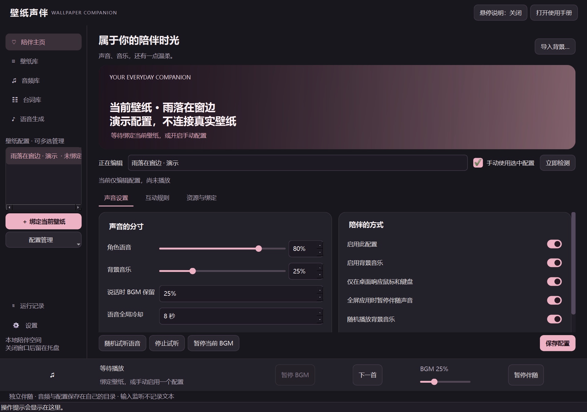
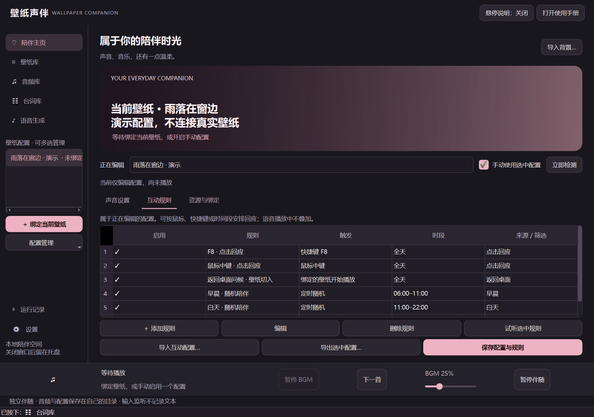
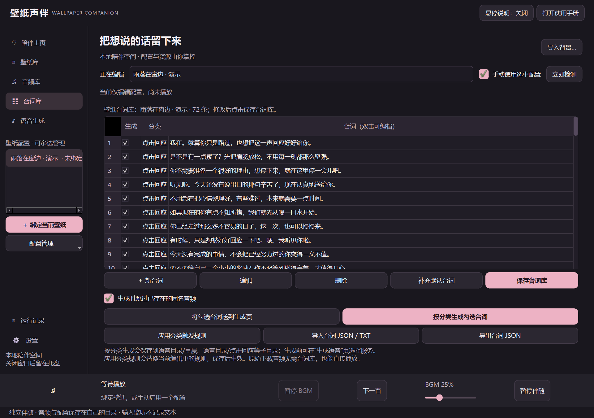

<div align="center">


# Wallpaper Companion

**壁纸声伴**

### Give your favorite wallpaper a voice.

A reply when you click. A good night when it gets late. Music while you work.

A standalone Windows app for interactive voice clips, scheduled greetings, and folder-based BGM alongside Wallpaper Engine.

[](https://github.com/Abs0lutely/wallpaper-companion/releases/latest) [](https://github.com/Abs0lutely/wallpaper-companion/actions/workflows/windows.yml) [](https://github.com/Abs0lutely/wallpaper-companion/releases/latest) [](LICENSE)

[简体中文](README.md) · **English**

[**Download for Windows**](https://github.com/Abs0lutely/wallpaper-companion/releases/latest) · [User guide (中文)](USER_GUIDE.md) · [Dialogue packs (中文)](examples/dialogues/README.md) · [Report an issue](https://github.com/Abs0lutely/wallpaper-companion/issues)



<sub>Actual app screenshot with disposable demo data. The interface supports Simplified Chinese and English. Change it in Settings → Runtime settings → Interface language, save, then exit from the tray and reopen. Screenshots below show the Chinese UI.</sub>

</div>

## Your wallpaper, your kind of company

Bind voice clips and music to the wallpaper you are using, then play them through mouse, keyboard, or time-based rules. Share resources across wallpapers or give each one its own collection. Wallpaper authors do not need to build in interactivity.

**Runs independently. Does not modify Wallpaper Engine or your downloaded wallpapers.**

| 🗨️ A little interaction | 🎵 Your own atmosphere | 🌸 Ready to try |
| :--- | :--- | :--- |
| Clicks, scrolling, recorded hotkeys, and scheduled greetings, with cooldowns and active hours. | Folder-based BGM, pause/skip/volume, cover artwork, and music ducking while a voice plays. | **90 bundled Chinese voice clips:** 38 companion lines and 52 operation responses. Try them first, then add your own. |

## Get started in three steps

1. **Download and run** — Get the installer or extract the complete portable ZIP from [Releases](https://github.com/Abs0lutely/wallpaper-companion/releases/latest). No Python, Conda, or AI setup is needed to play existing audio.
2. **Choose a wallpaper** — Play it in Wallpaper Engine, then choose **立即检测 → 绑定当前壁纸** (Detect now → Bind current wallpaper). To try the app first, create a profile and enable **手动使用选中配置** (Use selected profile manually).
3. **Preview and interact** — Use **随机试听语音** (Random voice preview) to try the bundled samples, then configure interaction rules. Import audio or generate it on the speech page when you want a different voice.

| How do you want to use it? | Download |
| :--- | :--- |
| Install normally and create shortcuts | `WallpaperCompanion-<version>-windows-x64-setup.exe` |
| Extract and run, keeping configuration beside the app | `WallpaperCompanion-<version>-windows-x64-portable.zip` |
| Verify download integrity | `SHA256SUMS.txt` |

> Extract the entire portable ZIP, keep `_internal` and `portable.flag`, and run `WallpaperCompanion.exe`. Closing the window keeps the app in the tray; exit through its tray menu. Launch at login is optional in Settings.

## Take a look

### Make interaction fit your routine

Configure mouse events, hotkeys, daily scheduled times, and random playback within a time window. Select dialogue categories and use cooldowns, filename filters, and time ranges—including ranges across midnight. Input rules respond only while the desktop is in the foreground by default; this is configurable per profile.



### Write the words, then give them a voice

Organize dialogue by category, select individual lines or categories, and import/export JSON or TXT. Review duplicate audio before generation. New files use `dialogue-model-name.wav`; you can also import recordings without using AI.



The separate **Gentle Replies** pack contains **72 original Chinese dialogue lines** for welcoming you back, greetings, and everyday reassurance. For example:

> You don't have to bring good news to come back. Even when you're tired, you deserve a warm welcome.
>
> What you didn't finish today doesn't erase the effort you've already made.

*English translations for this README; the downloadable pack is in Chinese.*

[Download dialogue JSON](https://github.com/Abs0lutely/wallpaper-companion/releases/latest/download/heartfelt-zh-CN.json) · [Browse the pack (中文)](examples/dialogues/README.md) · [52 operation-response lines (中文)](examples/dialogues/operation-zh-CN.json)

Want English or Japanese speech? **[Translated default dialogue packs](examples/dialogues/TRANSLATIONS.md)** provide 38 companion lines and 52 operation responses per language, with importable JSON, TXT, matching operation rules, and instructions. Import them and generate audio using a compatible voice; recordings are not included.

**Dialogue text and voice recordings are separate resources.** The 90 bundled clips are playable immediately. Additional imported or custom lines need matching recordings or TTS generation. The 72-line Gentle Replies pack contains text; it is not another 72 bundled recordings.

### Everyday details that make a difference

| Feature | What it does |
| :--- | :--- |
| Autosave and undo | Saves when switching pages or profiles, with a temporary undo notice. Manual save and restoring default options remain available. |
| Operation responses | Enabled by default and optional. Separate rules, categories, cooldowns, and import/export. Plays existing clips without starting an AI model for each click. |
| Audio library | Browse shared and per-profile folders, search, preview, multi-select, copy/import, and delete. Hover for full filenames and paths. |
| Wallpaper library | Scan, bind, or remove multiple profiles. Removing bindings keeps wallpaper, audio, and dialogue resources. |
| BGM player | Hides when BGM is disabled and supports cover artwork. Voice and BGM follow changes to the system's default audio output. |
| Personalization | Local background images, automatic accent colors, tray mode, optional launch at login, and hover help. |

## Want a different character voice?

Use a local GPT-SoVITS project or configure a third-party TTS endpoint. Preview reference audio and follow generation progress in the app.

| Provider | What you need |
| :--- | :--- |
| **GPT-SoVITS** | A local project, matching `.ckpt` / `.pth` weights, reference audio, and its exact transcript. Scan models and save character presets. |
| **Azure Speech** | A full synthesis endpoint, a key or key environment variable, voice ID, language, and rate. |
| **OpenAI-compatible TTS** | A full `/audio/speech` URL and the key, model, and voice required by your provider. |

Scanning, selecting, or saving characters does not load models. Start the local API on demand during generation, or manually start/stop the app-managed service. The app cleans up services it started when it exits. It does not automatically stop an external service; changing an external service's models requires separate permission.

The reference transcript must match the reference recording exactly. Keys use the system credential manager. Third-party services receive the synthesis text and may charge your account. See the [user guide (中文)](USER_GUIDE.md) for field-by-field help.

## Resources and personal data

Shared audio defaults to **`shared/` inside the installation or portable directory**. Existing folders can also be selected:

```text
WallpaperCompanion/
├─ WallpaperCompanion.exe
└─ shared/
   ├─ voice/             # Voice clips, optionally grouped by category
   ├─ bgm/               # Background music
   └─ dialogues.json     # Shared dialogue, created when saved
```

- **Installed app configuration:** `%LOCALAPPDATA%/WallpaperCompanion`. **Portable configuration:** `data/` beside the program.
- Per-profile resources default to `audio/<profile-ID>/` within the configuration data directory. Voice, BGM, and dialogue can each be shared or separate.
- Bundled samples are read-only resources in `examples/audio/` and do not overwrite personal files. Existing bindings and custom paths are not automatically migrated.
- Normal upgrades/uninstallation preserve user data and user-created shared resources. Keep `data/` and personal plugins when updating a portable copy; do not replace the entire user directory.

<details>
<summary><strong>Compatibility and scope</strong></summary>

- Windows 10/11 x64. Wallpaper integration requires Wallpaper Engine to be installed.
- WAV, MP3, OGG, FLAC, M4A, AAC, WMA, and OPUS are supported, subject to Qt/FFmpeg decoding capabilities.
- Original-wallpaper audio detection and conflict prevention cannot identify every scene or scripted sound. A manual policy is available.
- Interaction uses input events and time rules; it does not universally recognize moving character body parts in wallpapers.
- Wallpaper Engine, GPT-SoVITS models, personal settings, and personal music are not included.

</details>

## Share and build

Interaction JSON can share rules, dialogue, and playback parameters. It does not carry audio, models, keys, absolute paths, or executable plugin code. See the [interaction preset](examples/interaction-preset.json) and [operation-response rules](examples/presets/operation-voice-rules.json).

<details>
<summary><strong>Run from source and validate</strong></summary>

Requires Python 3.11+. With Conda:

```powershell
git clone https://github.com/Abs0lutely/wallpaper-companion.git
cd wallpaper-companion
.\setup.ps1
.\.conda\python.exe main.py
```

After setup, `start.cmd` can also launch the app. In your own virtual environment, install `requirements.txt`, then run `python main.py`.

```powershell
# Isolated configuration, resources, and mock services; no personal speech API
.\.conda\python.exe scripts\validate_ui.py
.\.conda\python.exe -m compileall -q companion main.py scripts
.\.conda\python.exe -m pip check
```

Built with Python, PySide6 / Qt Multimedia, pynput, requests, psutil, and keyring. Configuration is local JSON. Provider and backend extension points are documented in [EXTENSIONS.md (中文)](EXTENSIONS.md).

Use `WALLPAPER_COMPANION_DATA` to isolate test data and shared resources. `scripts/capture_readme.py` captures the actual UI with disposable demo data.

</details>

| Learn more | Documentation |
| :--- | :--- |
| Buttons and settings | [User guide (中文)](USER_GUIDE.md) |
| Third-party speech providers and other backends | [Extension API (中文)](EXTENSIONS.md) |
| EXE, installer, and portable builds | [Building (中文)](BUILDING.md) · [Release guide (中文)](RELEASE_GUIDE.md) |
| Continue development | [Project handoff (中文)](PROJECT_HANDOFF.md) |
| Licensing and dependencies | [MIT License](LICENSE) · [Third-party notices](THIRD_PARTY.md) |

---

<div align="center">

**A little scenery. A little music. A voice that feels like company.**

[Try it](https://github.com/Abs0lutely/wallpaper-companion/releases/latest) · [Report a problem or share an idea](https://github.com/Abs0lutely/wallpaper-companion/issues)

</div>
