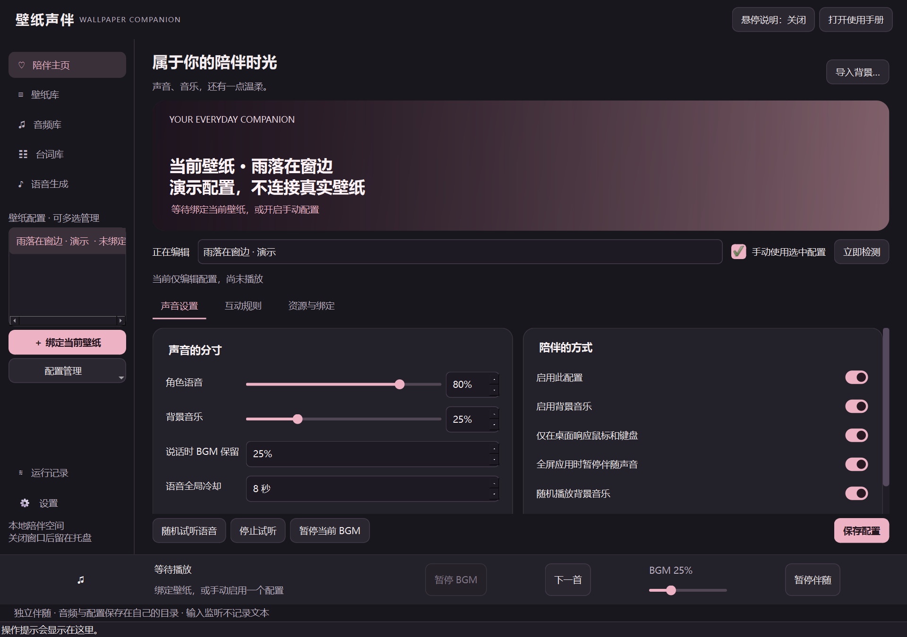
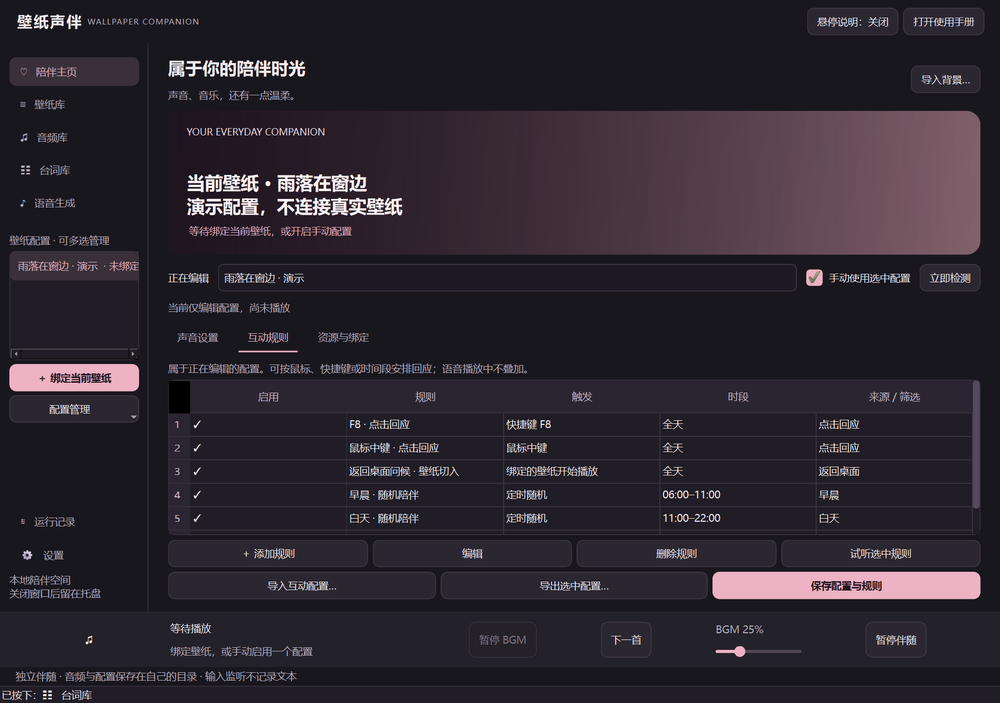
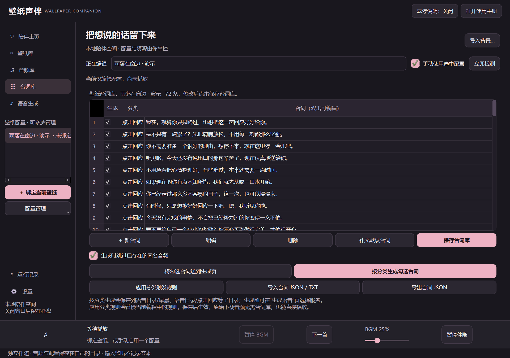

<div align="center">


# 壁纸声伴

**Wallpaper Companion**

### 让喜欢的壁纸，多一点声音与回应。

鼠标轻点时的一句回应，夜深时的一声晚安，还有陪你工作的背景音乐。

为 Wallpaper Engine 添加互动语音、时段问候与文件夹 BGM 的独立 Windows 应用。

[](https://github.com/Abs0lutely/wallpaper-companion/releases/latest) [](https://github.com/Abs0lutely/wallpaper-companion/actions/workflows/windows.yml) [](https://github.com/Abs0lutely/wallpaper-companion/releases/latest) [](LICENSE)

**简体中文** · [English](README.en.md)

[**下载 Windows 版**](https://github.com/Abs0lutely/wallpaper-companion/releases/latest) · [使用手册](USER_GUIDE.md) · [台词素材](examples/dialogues/README.md) · [反馈问题](https://github.com/Abs0lutely/wallpaper-companion/issues)



<sub>真实程序截图，使用独立演示配置。界面支持简体中文 / English，可在设置中切换，下次启动生效；截图保留中文演示。</sub>

</div>

## 一张壁纸，一份自己的陪伴

不需要壁纸作者预先制作互动：给当前壁纸绑定一套语音和音乐，就能按鼠标、键盘或时间规则播放。多张壁纸可以共用资源，也能各有自己的声音。

**独立运行，不修改 Wallpaper Engine 本体或已下载的壁纸。**

| 🗨️ 有回应 | 🎵 有氛围 | 🌸 打开就能试 |
| :--- | :--- | :--- |
| 点击、滚轮、录制快捷键，或按时间播放问候；设置冷却和时段，减少打扰。 | 文件夹 BGM、暂停/切歌/音量、说话时压低音乐；支持歌曲封面。 | 随附 **90 条中文配音**：38 条陪伴、52 条操作回应；先体验，再换成自己的音频。 |

## 三步开始

1. **下载运行** — 在 [Releases](https://github.com/Abs0lutely/wallpaper-companion/releases/latest) 下载安装包，或完整解压免安装 ZIP。普通用户无需 Python、Conda 或 AI 环境。
2. **选择壁纸** — 在 Wallpaper Engine 中播放壁纸，点击“立即检测 → 绑定当前壁纸”。也可以先新建配置，开启“手动使用选中配置”试用。
3. **试听与互动** — 点击“随机试听语音”，用随附配音检查播放，再配置自己的互动规则。需要自备声音时，导入音频或通过语音生成页制作。

| 你想怎样使用？ | 下载哪个文件？ |
| :--- | :--- |
| 日常安装、创建快捷方式 | `WallpaperCompanion-<版本>-windows-x64-setup.exe` |
| 解压后直接运行、配置随目录保存 | `WallpaperCompanion-<版本>-windows-x64-portable.zip` |
| 核对下载文件完整性 | `SHA256SUMS.txt` |

> 便携版请完整解压，保留 `_internal` 和 `portable.flag`，再运行 `WallpaperCompanion.exe`。关闭窗口后程序留在托盘，从托盘菜单退出；登录自启可在设置中开启。

## 看看它能做什么

### 让互动符合你的习惯

鼠标事件、快捷键、每日固定时刻、时段内随机播放，都在同一套规则界面配置。按台词分类选择播放内容，支持冷却、关键词和跨午夜时段。默认仅在桌面前台响应输入，可按配置调整。



### 先写下想说的话，再给它声音

台词库支持分类、自由多选、全选/全不选、JSON/TXT 导入导出。生成前检查重复音频，按“台词-模型名称.wav”保存；已有音频也可以直接导入，无需使用 AI。



另附 **《温柔回信》72 条原创中文台词**，适合欢迎、问候与日常安慰：

> 你不必带着好消息才回来，疲惫的你，也值得被好好欢迎。
>
> 今天没有完成的事情，不会把已经努力过的你变得一文不值。

[下载台词 JSON](https://github.com/Abs0lutely/wallpaper-companion/releases/latest/download/heartfelt-zh-CN.json) · [浏览全部台词](examples/dialogues/README.md) · [52 条操作回应台词](examples/dialogues/operation-zh-CN.json)

需要日语或英语？提供 **[默认台词日语 / 英语包](examples/dialogues/TRANSLATIONS.md)**，每种语言 38 条陪伴 + 52 条操作回应，附 JSON、TXT 和对应操作规则，可导入后自行生成配音。

**台词文字与配音是两种资源。** 随附 90 条配音可以直接播放；额外导入或自行编写的台词，仍需配套音频或通过 TTS 生成。《温柔回信》72 条是文字素材，不代表额外附赠 72 段配音。

### 常用的小细节，也照顾到了

| 功能 | 体验 |
| :--- | :--- |
| 自动保存与撤销 | 切换页面或配置时保存，短暂提示提供撤销；保留手动保存，支持恢复默认选项。 |
| 独立操作回应 | 默认开启，可关闭；单独设置规则、分类和冷却，支持导入/导出。只播放已有音频，不因点击临时启动模型。 |
| 音频库 | 管理共享与专用目录，搜索、试听、多选、复制导入和删除；悬停查看完整文件名与路径。 |
| 壁纸库 | 扫描、批量绑定与删除配置；删除绑定保留壁纸、音频和台词资源。 |
| BGM 播放 | 关闭时隐藏播放器，支持封面；语音与 BGM 跟随系统默认声音输出切换。 |
| 外观与日常使用 | 导入本地背景、自动取色、托盘、可选登录自启，以及控件悬停说明。 |

## 想用自己的角色声音？

可以使用本地 GPT-SoVITS，也可以配置第三方 TTS。参考音频可直接试听，生成页显示当前进度。

| 提供方 | 需要准备 |
| :--- | :--- |
| **GPT-SoVITS** | 本机项目、配套 `.ckpt` / `.pth`、参考音频及逐字原文。支持自动扫描模型、保存角色预设。 |
| **Azure Speech** | 完整合成 endpoint、密钥或密钥环境变量、voice ID、语言与语速。 |
| **OpenAI 兼容 TTS** | 完整 `/audio/speech` 地址，以及服务方要求的 Key、模型与音色。 |

扫描、选择和保存角色不会加载模型；生成时可按需启动本地 API，也能手动启动或关闭自建服务。退出应用时回收由它启动的服务，外部服务不会被自动关闭；切换外部服务模型需要单独许可。

参考原文必须逐字对应参考音频。密钥使用系统凭据管理器；第三方服务会收到待合成文本，并可能计费。详细设置见 [使用手册](USER_GUIDE.md)。

## 资源与个人数据

共享音频默认放在**程序安装目录或便携目录的 `shared/`**，也能选择已有文件夹：

```text
WallpaperCompanion/
├─ WallpaperCompanion.exe
└─ shared/
   ├─ voice/             # 语音，可按早晨、夜间等分类
   ├─ bgm/               # 背景音乐
   └─ dialogues.json     # 保存后产生的共享台词
```

- **安装版配置：** `%LOCALAPPDATA%/WallpaperCompanion`；**便携版配置：** 程序旁 `data/`。
- 壁纸专用资源默认在配置数据目录的 `audio/<配置ID>/`，可分别共享或单独设置语音、BGM 与台词。
- 随附默认配音位于只读 `examples/audio/`，不覆盖个人资源。已有绑定和自定义路径不会自动迁移。
- 正常升级/卸载保留用户数据和用户创建的共享资源；更新便携版请保留 `data/` 与个人插件，勿覆盖整个用户目录。

<details>
<summary><strong>兼容性与使用边界</strong></summary>

- 支持 Windows 10/11 x64；壁纸联动需要已安装 Wallpaper Engine。
- 音频支持 WAV、MP3、OGG、FLAC、M4A、AAC、WMA、OPUS，实际解码取决于 Qt/FFmpeg。
- 原壁纸音频检测与防冲突不能保证识别所有场景或脚本音频，可手动调整策略。
- 互动基于输入事件与时间规则，不通用识别壁纸中移动角色的身体部位。
- 不包含 Wallpaper Engine、GPT-SoVITS 模型、个人配置或个人音乐。

</details>

## 分享与开发

分享互动 JSON 可携带规则、台词和播放参数，不携带音频、模型、密钥、绝对路径或可执行插件代码。参考 [互动预设](examples/interaction-preset.json) 与 [操作回应规则](examples/presets/operation-voice-rules.json)。

<details>
<summary><strong>从源码运行与验证</strong></summary>

需要 Python 3.11+。可使用 Conda：

```powershell
git clone https://github.com/Abs0lutely/wallpaper-companion.git
cd wallpaper-companion
.\setup.ps1
.\.conda\python.exe main.py
```

环境准备后也可双击 `start.cmd`。使用自己的虚拟环境时，安装 `requirements.txt` 后运行 `python main.py`。

```powershell
# 隔离配置、资源与模拟服务，不使用个人语音 API
.\.conda\python.exe scripts\validate_ui.py
.\.conda\python.exe -m compileall -q companion main.py scripts
.\.conda\python.exe -m pip check
```

技术栈：Python · PySide6 / Qt Multimedia · pynput · requests · psutil · keyring。配置使用本地 JSON；扩展提供方和后端见 [EXTENSIONS.md](EXTENSIONS.md)。

设置 `WALLPAPER_COMPANION_DATA` 可隔离测试数据，共享资源也跟随隔离目录。`scripts/capture_readme.py` 使用演示配置生成真实界面截图。

</details>

| 想了解什么 | 文档 |
| :--- | :--- |
| 每个按钮与输入框的用途 | [完整使用手册](USER_GUIDE.md) |
| 接入第三方语音和其他后端 | [扩展接口](EXTENSIONS.md) |
| 构建 EXE、安装包与便携版 | [构建说明](BUILDING.md) · [发布流程](RELEASE_GUIDE.md) |
| 继续维护代码 | [项目交接](PROJECT_HANDOFF.md) |
| 许可与依赖 | [MIT License](LICENSE) · [第三方声明](THIRD_PARTY.md) |

---

<div align="center">

**让桌面不止有风景，也有一句恰好听见的话。**

[下载体验](https://github.com/Abs0lutely/wallpaper-companion/releases/latest) · [报告问题 / 提出想法](https://github.com/Abs0lutely/wallpaper-companion/issues)

</div>
